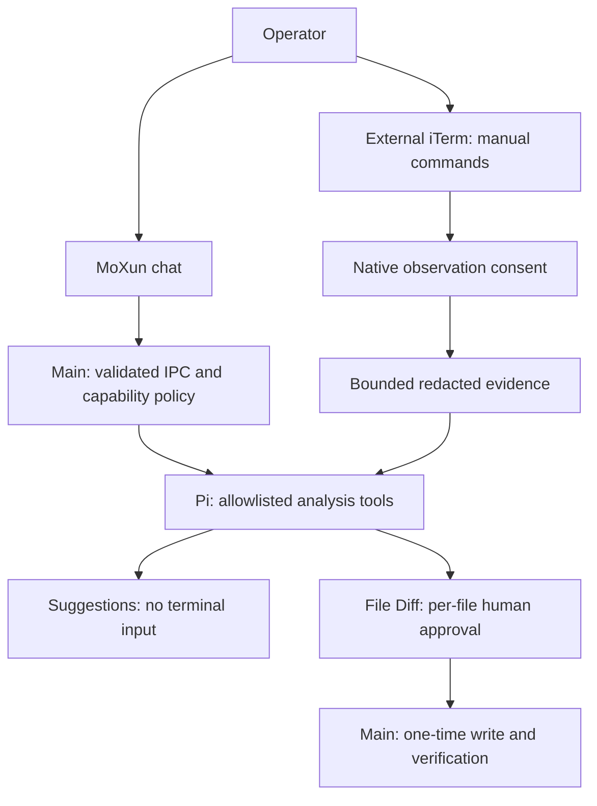

# 墨巡 · MoXun

English | [简体中文](README.zh-CN.md)

A chat-first operations workbench built with Electron, React and TypeScript. MoXun helps you analyze authorized evidence, understand risks and preserve operational knowledge. **You operate the terminal in external iTerm; the Agent never executes, types or interrupts terminal commands.** The repository, package identity and application data directory retain the Crescent name for compatibility.

## Current capabilities

- Chat-first workspace with a fixed composer, model selection and optional session details.
- Local and saved SSH connections, `~/.ssh/config`, favorites, search, ordering, imports and user-configured login actions.
- Open a new shared iTerm, or bind an existing iTerm read-only. The standalone terminal entry does not implicitly connect a cluster.
- Optional AI observation: off by default, observe from now, or include accessible current context and continue. Enabling/resuming requires Main's native confirmation. Observation never grants input permission; snapshots may omit output and cannot establish exit codes.
- Authorized, bounded local document reading, code indexing, memory and knowledge retrieval.
- Local file changes through complete Diff review, per-file approval, one-time Main authorization, hash checks and post-write verification. Rejection leaves bytes unchanged.
- Read-only child analysis, Skills and SOP drafts; knowledge is saved only through the host confirmation flow.

There is no embedded terminal workspace and no Agent `bash`, `write`, `edit` or `open_subterminal` capability. MCP settings/discovery are not execution permission: the reviewed implementation allowlist is empty, so Agent MCP connections/calls are disabled. OpenAPI settings remain for legacy migration, not current Agent tools.

## Workflow

1. Configure a model provider and select a model.
2. Describe your problem in chat. A suggestion can be based on your description and target metadata without claiming observed results.
3. If needed, select a connection or open/bind iTerm. Choose whether AI may observe this session.
4. Review suggestions and type commands yourself in iTerm. Grant observation only for evidence you want analyzed.
5. Review local file changes individually; preserve useful conclusions as Skills/SOPs.



## Install and build

Check [GitHub Releases](https://github.com/aide-family/Crescent/releases) for actually available assets and verify their published SHA-256 checksums. Current Mac delivery uses **one Universal app, DMG and ZIP containing x64 and arm64**, not separate architecture packages. Signing/notarization depends on configured release credentials; do not assume every historical download is signed or validated. Windows/Linux workflow targets remain, but current local adaptation and acceptance focus on macOS.

Node.js **22.19+** is required:

```bash
npm ci
npm run dev

# Full local verification; tests stay local-only
npm run verify:local

# Unsigned Universal delivery, no publishing
npm run build:mac:local
```

`npm run build` typechecks and compiles without packaging. `npm run build:mac` uses separately configured signing/notarization. Legacy Mac `:x64`/`:arm64` scripts are Universal aliases. Never rebuild `out/` while packaging is reading it. Keep required node-pty prebuilds, Pi/Photon WASM, PDF worker and code-index resources.

## Documentation

- [Documentation index](Document/INDEX.md)
- [Architecture](Document/ARCHITECTURE.md) · [Security model](Document/SECURITY_MODEL.md)
- [External terminals](Document/EXTERNAL_TERMINALS.md) · [UI design](Document/UI_DESIGN_SYSTEM.md)
- [Source build](SOURCE_BUILD.md) · [Development](Document/DEVELOPMENT.md)
- [Local testing](Document/TESTING.md) · [Signing](Document/CODE_SIGNING.md)
- [Roadmap](ROADMAP.md) · [Changelog](CHANGELOG.md)
- [Website](https://aide-family.github.io/Crescent/en/)

Issues, pull requests and reusable operational Skills are welcome at [aide-family/Crescent](https://github.com/aide-family/Crescent). Do not commit local `*.test.ts` files or bypass repository verification hooks.
