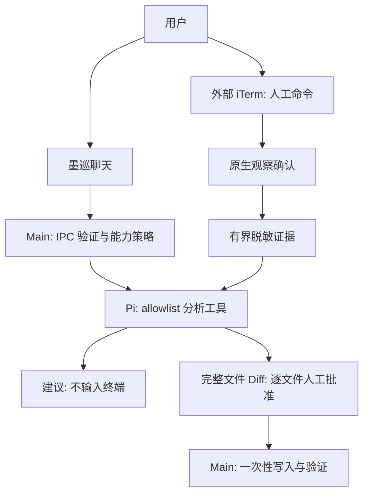

# 墨巡 · MoXun

[English](README.md) | 简体中文

基于 Electron、React 和 TypeScript 的聊天优先运维协作台。墨巡帮助你分析授权证据、理解操作风险、沉淀排障知识。**所有终端命令由你在外部 iTerm 操作；Agent 永远不能执行、输入或中断命令。** 仓库、package 标识与应用数据目录保留 Crescent 名称以兼容历史数据。

## 当前能力

- 聊天主工作区、固定输入框、模型选择，会话详情默认折叠。
- 本机/SSH 连接、读取 `~/.ssh/config`、收藏、搜索、排序、导入及用户配置的登录动作。
- 新建共享 iTerm，或只读绑定已有 iTerm。独立外置终端入口不隐式连接集群。
- 可选 AI 观察：默认不参与、从现在开始观察、加入当前可访问上下文并继续观察。开启/恢复须 Main 原生确认；观察不授予输入权限，快照可能不完整且不能证明退出码。
- 有授权、有限量的本地资料读取、代码索引、memory 与知识检索。
- 本地文件变更必须完整 Diff、逐文件批准、Main 一次性授权、摘要复核及写后验证；拒绝后文件字节不变。
- 只读子任务分析、Skills 和 SOP 草稿，通过宿主确认流程沉淀知识。

不提供内嵌终端主工作区，不开放 Agent `bash`、`write`、`edit` 或 `open_subterminal` 能力。MCP 设置/目录发现不是调用许可：当前已审计实现名单为空，Agent MCP 连接和调用关闭。OpenAPI 设置仅用于历史迁移，不是当前 Agent 工具。

## 使用流程

1. 配置模型供应商并选择模型。
2. 在聊天中描述问题；无观察证据时，建议只基于问题及目标信息，不声称已检查终端结果。
3. 按需选择连接，或新建/绑定 iTerm，选择本轮是否允许 AI 观察。
4. 阅读建议，在 iTerm 自己输入命令；只授权你希望分析的证据。
5. 逐文件审核本地变更，将有用结论沉淀为 Skill/SOP。



## 安装与构建

从 [GitHub Releases](https://github.com/aide-family/Crescent/releases) 核对实际可下载资产，并验证发布的 SHA-256。当前 Mac 交付是 **一份包含 x64 + arm64 的 Universal app、DMG 和 ZIP**，不是按架构拆包。签名/公证依赖发布凭据，不把历史包都视为已签名或已验收。Windows/Linux workflow 目标保留，但当前本地适配及验收聚焦 macOS。

需要 Node.js **22.19+**：

```bash
npm ci
npm run dev

# 完整本地门禁；单测只留本机
npm run verify:local

# 未签名 Universal 交付，不发布
npm run build:mac:local
```

`npm run build` 类型检查并编译，不打包；`npm run build:mac` 需要单独配置签名/公证。旧 Mac `:x64`/`:arm64` 命令都是 Universal alias。打包读取 `out/` 时禁止同时重建。node-pty prebuild、Pi/Photon WASM、PDF worker、代码索引资源必须保留。

## 文档

- [文档索引](Document/INDEX.md)
- [架构](Document/ARCHITECTURE.md) · [安全模型](Document/SECURITY_MODEL.md)
- [外部终端](Document/EXTERNAL_TERMINALS.md) · [UI 规范](Document/UI_DESIGN_SYSTEM.md)
- [源码构建](SOURCE_BUILD.md) · [开发规范](Document/DEVELOPMENT.md)
- [本地测试](Document/TESTING.md) · [签名](Document/CODE_SIGNING.md)
- [路线图](ROADMAP.md) · [变更日志](CHANGELOG.md)
- [文档网站](https://aide-family.github.io/Crescent/)

欢迎在 [aide-family/Crescent](https://github.com/aide-family/Crescent) 提交问题、PR 和可复用运维 Skills。不要提交本地 `*.test.ts`，不要跳过项目门禁。
